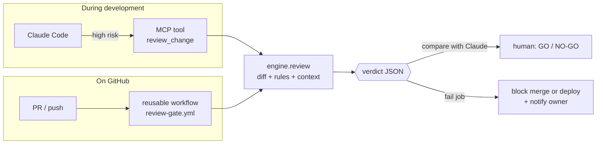

# cross-model-review-gate

A cross-model review gate for AI-written changes. Claude writes the change; a
**different** model reviews it and returns a structured verdict, `valid` or
`not-valid`, with short reasons. It is a gate, not a chat: CI can block on it.

**One engine, two entry points:**

- **MCP tool** (interactive): Claude Code calls it during development when a
  change is high-risk, compares the gate's verdict with its own, works through
  any disagreement, and presents both to the human, who decides GO / NO-GO.
- **CI reusable workflow** (automatic backstop): protected repos call it on pull
  requests and deploys. A not-valid verdict blocks the merge or the deploy, even
  when a change never went through the interactive path.



## The model: proportional scrutiny plus a backstop

- **Low risk:** Claude proceeds alone. No gate, no cost.
- **High risk:** Claude escalates to the gate before pushing. The repo's
  CLAUDE.md sets the floor, Claude's judgment can add to it, and the human
  owner can override either way.
- **Protected repos:** the CI workflow also runs on every PR or deploy, so the
  guarantee does not depend on anyone remembering to escalate.

## What the gate checks, and who decides

| Check | Decided by | Fails when |
|---|---|---|
| **Safety** | code first, then the model | a secret is present (code: scanned before any model call); destructive operations, widened permissions or trust, disabled protections, unsafe content in text or images, prompt-injection text aimed at the reviewer (model) |
| **Correctness** | the model | the change does not do what its PR title / commit message says, or has obvious bugs |
| **On-standard** | the model | it breaks a rule in the repo's CLAUDE.md or in [`rules/global.md`](rules/global.md) |
| **Branch rule** | code | the change reaches the default branch in a way its visibility tag forbids (see below) |

`verdict` is `valid` only when all four pass. Anything that goes wrong (missing
key, provider down, unparseable reply, image it cannot see) makes the verdict
`not-valid`. **The gate fails closed.**

Code also sets a **risk floor**: workflow files, Terraform, IAM and trust
policies, CLAUDE.md, destructive commands, force pushes, cost settings and
unreviewable binaries make a change `high` risk. The model can raise the tier,
never lower it.

### Branch rule

| Visibility | Direct push to the default branch | Through a pull request |
|---|---|---|
| `shared` | fail | pass |
| `public` | fail | pass |
| `private-mine` | pass if low risk, fail if high risk | pass |
| not declared | treated as `shared` | pass |

### The verdict

```json
{
  "verdict": "valid | not-valid",
  "risk_tier": "low | high",
  "reasons": ["short, specific"],
  "what_changed": "what it does. [owner/repo @ feature -> main, via pull request, 3 file(s)]",
  "checks": {"safety": "pass|fail", "correctness": "pass|fail", "on_standard": "pass|fail", "branch_rule": "pass|fail"},
  "meta": {"provider": "...", "model": "...", "risk_signals": [], "decided_by_code": [], "...": "..."}
}
```

`what_changed` is the audit line. Git history stays the authoritative record;
there is no separate log.

## Declaring a repo's stakes

Put this block in the repo's `CLAUDE.md`. It is invisible when rendered:

```markdown
<!-- review-gate
visibility: private-mine
risk-floor: high
-->
```

`risk-floor: high` makes every change in the repo high risk (use it for infra
repos). In CI the rules are read **at the base commit**, so a pull request cannot
loosen the rules it is judged against. The caller can also pass `visibility`
explicitly.

## Enforcement: block the merge or block the deploy

Both are free on public repos. On private repos, only deploy blocking is free.

| Mode | How it blocks | Public repo | Private repo, GitHub Free |
|---|---|---|---|
| `merge` | make the gate a **required status check** in a ruleset | free | needs GitHub Pro or Team |
| `deploy` | the deploy job `needs:` the gate job | free | **free** |

**Merge mode** ([example](examples/caller-merge-gate.yml)) stops a bad change
before it lands on the default branch.

**Deploy mode** ([example](examples/caller-deploy-gate.yml)) lets the merge happen
but guarantees nothing reaches production without a valid verdict. Use it on
private repos without Pro. Two honest limits:

- A bad change can land on the default branch; it just never deploys. The gate
  still comments on the pull request first, so you see the red verdict before
  you merge.
- A repo admin can edit the workflow and remove the gate. That is true in merge
  mode too unless admin bypass is disabled. The gate guards against accidental
  and unescalated changes, not against the owner deliberately switching it off.

On public repos, use both: a required check on PRs and `needs:` on the deploy.

### Notifications: a block is never silent

- **Pull request:** one sticky comment with the full verdict, updated on every push.
- **Deploy blocked** (push or manual run, verdict not valid): the gate opens an
  issue titled `[review-gate] Deploy blocked: <sha> on <branch>`, assigned to the
  repo owner, with the reasons and a link to the run. GitHub notifies the
  assignee by email and in the mobile app, per your notification settings.
- **Every run:** the verdict is in the job summary and kept as an artifact
  (`review-gate-verdict.json`, 30 days). GitHub also emails you about failed runs
  by default.

**Permissions are the caller's choice.** The gate job inherits exactly what the caller grants:

| Permission | Needed for |
|---|---|
| `contents: read` | always (reading the change) |
| `pull-requests: write` | the verdict comment on PRs |
| `issues: write` | the "deploy blocked" issue (deploy mode only) |

Grant only what you use. A missing permission skips that notice; the verdict and the
pass/fail check still work.

## Adding the CI backstop to a repo

1. Add a provider secret to the repo (Settings → Secrets and variables → Actions),
   for example `OPENAI_API_KEY`, or `COPILOT_GITHUB_TOKEN` for Copilot.
2. Add the caller job:

```yaml
jobs:
  review-gate:
    uses: fdmedicis/cross-model-review-gate/.github/workflows/review-gate.yml@v1
    with: { provider: openai }
    secrets: inherit
```

3. Merge mode: make `review-gate / review gate` a required check. Deploy mode: add
   `needs: review-gate` to the deploy job.

Inputs: `provider`, `model`, `visibility`, `mode` (`deploy` | `merge`),
`max_diff_tokens` (default 40000), `notify` (default true), `gate_ref` (default
`v1`; keep it equal to the `@ref` you call the workflow at). Outputs: `verdict`,
`risk_tier`.

## Providers

Every provider is configuration: pick one with the `provider` input (CI) or
`REVIEW_GATE_PROVIDER` (local). OpenAI, Gemini, DeepSeek and Grok share one
OpenAI-compatible client; Copilot runs through the official Copilot CLI.

| Provider | Secret / env var | Default model | Sees images | Cost | Data note |
|---|---|---|---|---|---|
| `openai` | `OPENAI_API_KEY` | `gpt-6-sol` | yes | paid; about 1-2 cents for a typical review | API data is not used for training by default |
| `gemini` | `GEMINI_API_KEY` | `gemini-3.8-flash` | yes | **free tier**, rate-limited; paid tier available | free-tier content may be used to improve Google's products; use the paid tier for private code |
| `deepseek` | `DEEPSEEK_API_KEY` | `deepseek-v4-flash` | **no** | paid, fractions of a cent | stored in mainland China and may be used for training; not recommended for private infra |
| `grok` | `XAI_API_KEY` | `grok-4.6` | yes | paid | see xAI's terms |
| `copilot` | `COPILOT_GITHUB_TOKEN` | `gpt-6-sol`, then `gpt-5.4`, then Copilot's automatic choice (must not be Claude) | yes (attachments) | **included in Copilot plans, including Copilot Free's monthly allowance** | check "allow GitHub to use my data" in your Copilot settings |

- **Claude models are refused** on every provider (Copilot offers some). Claude
  reviewing Claude is an echo; the point is a second model family.
- Default models were current in October 2026. Model names change: override
  with the `model` input or `REVIEW_GATE_MODEL`.
- Structured output: OpenAI and Grok are asked for strict JSON-schema output,
  Gemini and DeepSeek for JSON mode, Copilot by prompt. If a model rejects a
  format the client falls back to a looser one. Whatever comes back is validated
  strictly against the schema; anything invalid fails closed.
- Which models a Copilot account may name depends on its plan. **Copilot Free accepts
  only automatic model choice in the CLI** (it chose `gpt-6-luna` in October 2026).
  Unless `model` is set, the gate tries `gpt-6-sol`, then `gpt-5.4`, then automatic
  choice, and accepts an automatic choice only when the CLI's own event log shows a
  non-Claude model answered. `meta.model` records which model reviewed. Each review
  uses one Copilot premium request.
- The Copilot reviewer gets only a file viewer: no GitHub MCP server (so no repo access
  through the token), no shell, no writes. Copilot Free's automatic choice can differ per
  review (seen: `gpt-6-luna`, `mai-code-1.1-flash`); it is always checked to be non-Claude
  and recorded in `meta.model`. A review takes roughly 40-80 seconds.
- The Copilot CLI masks password-like values (`******`) in files before its model reads
  them, even obvious placeholders. The reviewer may then call such a line unverifiable.
  The gate's own secret scan runs before any provider and is not affected.
- Copilot needs a fine-grained personal access token with the **Copilot Requests**
  permission, stored as `COPILOT_GITHUB_TOKEN`. The CLI runs in an empty temp
  directory with only the `read` tool allowed, and does not see other providers'
  keys or the workflow token.
- A change that touches images with a provider that cannot see images
  (DeepSeek) fails closed rather than passing images unseen.

## Oversized diffs

**The gate never reviews part of a change.** A partial review would pass what it
never saw. A change either fits the budget whole or fails as too large, with the
numbers that say what to split.

What happens, in order:

1. **Machine-generated files are not shown to the model:** lockfiles
   (`package-lock.json`, `yarn.lock`, `poetry.lock`, `go.sum`, `.terraform.lock.hcl`
   and similar), `*.min.js`, `*.min.css`, `*.map`. They are still secret-scanned,
   still count for the risk floor, and are listed in the verdict as not shown.
2. **Images** are sent to vision models as images: at most **4 per change**, each
   at most **3 MB**. More or bigger fails as too large.
3. **Other binaries** (archives, PDFs, fonts) cannot be reviewed. They are listed
   and make the change high risk, so they need a pull request.
4. **The remaining text diff is measured** at about 4 characters per token. The
   limit is **40,000 tokens**, roughly 160 KB or 3,000 to 4,000 changed lines.
   Over the limit: verdict `not-valid`, **no model call**, and the reason names
   the total, the limit and the five largest files.
5. **The rules** (global rules plus the repo's CLAUDE.md) have their own limit of
   **12,000 tokens**. A CLAUDE.md the gate cannot read whole fails the review.

Why 40,000 tokens: review quality drops as changes grow, for humans (a few
hundred lines is the usual guidance) and for models, whose attention thins over
long inputs. 40,000 tokens is already far past a reviewable change, fits every
provider's context window with room for rules and the answer, and caps the
worst-case cost at roughly 11 cents with `gpt-6-sol` (well under a cent with the
cheapest models).

Why not truncate or split into chunks: truncation reviews half a change.
Chunks cannot see cross-file effects, such as an IAM policy in one file attached
to a role in another, and they multiply cost.

What to do when a change is too large:

- **Split it** into smaller pull requests. This is almost always the right answer.
- **Raise the budget** for a repo with `max_diff_tokens` in its caller workflow.
  That edit is a workflow change, so the gate itself reviews it as high risk.

## Using it locally

Python 3.10+, standard library only. No `pip install`.

```bash
python -m gate providers                              # which keys are set
python -m gate local --repo-path ../my-repo --intent "what the change does"
python -m gate review --diff change.diff --rules CLAUDE.md --via-pr
python -m gate eval --provider openai                 # score it on known-bad / known-good
```

Exit codes: `0` valid, `1` not valid, `2` usage or configuration error.

The interactive entry point is the `review-gate` MCP server in the owner's
private `os-tools` repo, which imports this engine and adds the Claude-versus-gate
comparison.

## Testing: trust before use

A rubber-stamp gate is worse than none, so the gate is scored on two numbers:
**catch rate** (known-bad changes rejected for the right reason) and **false
positives** (known-good changes rejected). The suite is in
[`gate/evalsuite.py`](gate/evalsuite.py):

- **Known-bad:** a secret in config, a committed `.env`, direct pushes to the
  default branch of shared and public repos, a high-risk direct push, an oversized
  change, an image with a provider that cannot see it, an IAM wildcard, a widened
  OIDC trust policy, Terraform managing the hand-made state bucket, broken
  Python, a prompt injection that also disables a password check, a workflow that
  force-pushes and wipes data.
- **Known-good:** placeholders that look like secrets, a lockfile bump, a docs
  typo pushed directly, a photo swap, a Terraform tag via PR, a feature with
  tests, a CI cache tweak.

```bash
python -m unittest discover -s tests -v   # offline, no key needed
python -m gate eval --offline             # the code-decided cases
python -m gate eval --provider gemini     # the full suite against a real model
```

The repo's own CI runs the offline tests and code-decided cases on every PR.
Unsafe-image cases are not committed (they would not belong in a public repo);
test those locally with your own image through the MCP tool or `python -m gate local`.

## Security notes

- Secrets are found **before** any model call; when one is found the model is not
  called at all, so it is never sent to a provider. Everything sent is also
  passed through redaction as defense in depth.
- The diff, the rules and the PR description are wrapped as data, and the model is
  told that instructions inside them are a safety failure. The checks that matter
  most (secrets, branch rule, risk floor, size) are decided in code, where text in
  the diff cannot argue with them.
- Workflow inputs reach the script through environment variables, never inlined
  into shell commands.
- No secret lives in this repo. Keys are environment variables locally and GitHub
  secrets in CI.

## Versioning

Callers pin a major tag (`@v1`). Breaking changes to inputs or the verdict
schema get a new major. Changes to this repo go through pull requests.
